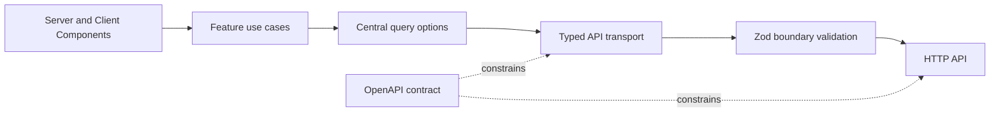

# Deliver a mobile-first web client without coupling it to an unfinished API

The client uses a thin contract boundary: OpenAPI describes the wire format, Zod validates untrusted responses, and application code consumes validated models. Server Components remain the default; client-side state and animation stay in small interactive leaves.

## Implemented authentication exception

The initial email/password integration uses [API.md](API.md) as its interim wire reference because the OpenAPI draft still has no operations. Its JSON login request, snake_case responses, numeric IDs, and `{detail}` errors are validated/adapted at the HTTP boundary, not exposed to components. This is scoped to login and `/auth/me`; the long-term reviewed OpenAPI policy below is unchanged.

The flow is server action → use case → auth gateway → HTTP/Zod adapter. Server-only modules own configuration and cookies. No token enters browser storage or serialized component props. Protected pages each validate the current user; React request memoization avoids duplicate checks within a render. Framework layouts alone are not treated as authorization boundaries. Other business routes remain explicit placeholders.

Google and X sign-in follow the same boundary: thin route handlers (`/auth/[provider]`, `/auth/[provider]/callback`) call `server/oauth-flow.ts`, which uses an `OAuthProvider` abstraction (PKCE S256, state in a 10-minute HttpOnly path-scoped cookie, compared in constant time), then the `loginWithProvider` use case and `AuthGateway` (`POST /auth/google` with `id_token`, `POST /auth/x` with `access_token`). Provider tokens stay server-side and backend `detail` text is never shown. Config (server-only): `APP_URL`, `GOOGLE_CLIENT_ID/SECRET`, `X_CLIENT_ID/SECRET`; missing credentials disable that provider. The callback URLs `${APP_URL}/auth/google/callback` and `${APP_URL}/auth/x/callback` must be registered in Google Cloud Console and the X developer portal. X users have a placeholder email that the UI hides.

No Query provider or animation runtime is mounted without a concrete use case. Tanker (display) and Nippo (UI) load through `next/font/local` from `src/app/fonts/`. The `.woff2` files are git-ignored (ITF FFL forbids redistribution) and fetched by `pnpm fonts:fetch`, which runs automatically before `dev` and `build`. If the files are missing and the download fails, the script exits non-zero with instructions (network + `unzip`, or copy the files manually from fontshare.com); the build does not silently fall back.

## Decision status

Labels in this document are deliberate:

- **Normative:** required for the initial product.
- **Proposed:** preferred direction pending implementation evidence.
- **Open:** requires an explicit decision before affected work starts.

## Architecture decisions

| Status | Area | Decision |
| --- | --- | --- |
| Normative | Product surface | Build a web application for predominantly mobile use. Mobile-first behavior is a hard constraint, not a later responsive pass. |
| Normative | Framework | Use Next.js App Router with strict TypeScript. Prefer Server Components and isolate browser-only behavior in small Client Components. |
| Normative | Styling | Use Tailwind CSS. Unprefixed utilities define the mobile baseline; add larger breakpoints upward. Prefer container queries for reusable components. |
| Normative | API contract | Treat `contracts/openapi.yaml` as the reviewed wire-contract source of truth. Do not mirror accidental backend structures. |
| Normative | Runtime validation | Parse API JSON from `unknown` with Zod at transport boundaries. Unvalidated payloads do not enter application code. |
| Normative | Server state | Use TanStack Query where browser caching, background refresh, mutations, or invalidation provide value. Do not use it for every fetch by default. |
| Normative | Motion | Use GSAP with `@gsap/react`; scope cleanup with `useGSAP`, adapt with `gsap.matchMedia`, and honor reduced-motion preferences. |
| Normative | Images | Consume API-provided image URLs. Do not copy or bundle the backend bootstrap image catalog. |
| Proposed | Contract tooling | Generate static TypeScript types from OpenAPI while keeping hand-owned Zod schemas at external runtime boundaries until generation is proven reliable. |
| Open | Rendering policy | Decide per route which data is server-fetched, prefetched for hydration, or fetched only in the browser. |

## Boundaries

Dependencies point toward stable application concepts. Components do not assemble URLs, decode arbitrary JSON, or know backend persistence shapes.

## Dependency responsibilities

| Dependency | Owns | Must not own |
| --- | --- | --- |
| Next.js App Router | Routing, layouts, rendering boundaries, server integration | Domain rules or response validation |
| Tailwind CSS | Layout and visual primitives from the mobile baseline upward | Component behavior or domain state |
| TanStack Query 5 | Browser server-state cache, mutations, invalidation, background refresh | Local presentation state or the API contract |
| Zod 4 | Runtime parsing and useful validation failures at external boundaries | Network transport or UI rendering |
| GSAP 3 + `@gsap/react` | Intentional interaction and transition motion | Essential navigation, content access, or state correctness |

## Data-flow rules

1. A transport function receives JSON as `unknown`.
2. A contract-layer Zod schema parses it.
3. The transport returns only validated data or a normalized error.
4. Centralized `queryOptions` define stable keys and fetch behavior.
5. Server rendering uses a request-scoped QueryClient when prefetching; the browser uses one persistent QueryClient and hydrates through `HydrationBoundary`.
6. Hydrated queries use a non-zero `staleTime` to avoid an immediate duplicate request.

## Mobile-first non-negotiables

- Design and acceptance checks start at narrow viewports and enhance upward.
- Primary actions remain reachable and usable with touch; target sizes and spacing must not depend on pointer precision.
- Layouts must tolerate browser chrome, safe areas, virtual keyboards, long labels, and text zoom.
- Core flows must work without hover, wide tables, or motion.
- Test on representative small screens and real mobile browsers before considering a slice complete.

## Performance and accessibility constraints

- Keep client JavaScript bounded by using Server Components as the default.
- Reserve image dimensions or aspect ratios to avoid layout shift; loading strategy is decided per use case.
- Prefer CSS for simple transitions. GSAP is for motion that benefits from sequencing or imperative control.
- Respect `prefers-reduced-motion`; reduced motion must preserve meaning and task completion.
- Use semantic HTML, visible focus, keyboard access, labeled controls, and sufficient contrast.
- Measure performance with production builds and mobile conditions; do not optimize from development-mode impressions.

## Deliberately absent dependencies

Axios, Redux/Zustand, form libraries, and UI kits are not part of the baseline. Add one only when a concrete requirement outweighs native platform or current-stack capabilities.

## Non-goals

- Defining domain endpoints before product and backend behavior are agreed.
- Reproducing backend database models in the browser.
- Shipping backend bootstrap assets with the client.
- Establishing authentication, offline support, analytics, or a design system before requirements exist.
- Using animation to hide latency or block access to content.

## References

- [API contract policy](../contracts/api-contract-policy.md)
- [OpenAPI draft](../../contracts/openapi.yaml)

